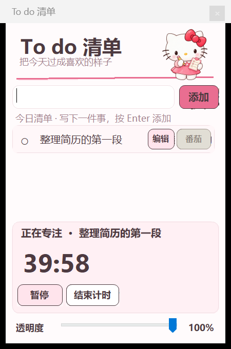

# To do 清单

一个 Windows 桌面待办和番茄钟小工具。写下今天要做的事，选择一个番茄钟开始专注，也可以把窗口缩成桌面上的人物头像。



截图中的待办是演示内容。其他主题的界面示例：[库洛米](docs/kuromi-window.png) · [海绵宝宝](docs/spongebob-window.png) · [哆啦 A 梦](docs/doraemon-window.png)。

## 下载和使用

1. 下载 [Windows 程序压缩包](<dist/To do 清单-主题版.zip>)。在 GitHub 文件页面可使用下载按钮。
2. 解压后，双击 `To do 清单.exe`。
3. 写下待办并点击“添加”，再点击事项旁的“番茄”开始计时。
4. 点击窗口右上角的齿轮，可以设置 25–60 分钟的专注时间并切换主题。时长修改从下一轮开始生效。
5. 点击最小化按钮，窗口会变成人物头像；拖动头像可移动，点击头像可展开。
6. 点击关闭按钮会收进系统托盘，计时继续。点击任务栏右下角的程序图标可重新打开；右键图标可选择“退出程序”。图标可能藏在 `^` 菜单中。

## 功能

- 创建、编辑、完成和删除待办，调整窗口透明度。
- 每条待办都可开始番茄钟。专注结束后可选择休息 5 分钟或开始下一轮。
- 在蜡笔小新、Hello Kitty、库洛米、海绵宝宝、哆啦 A 梦五套主题间切换；窗口缩小时显示对应人物头像。
- 关闭窗口后继续在后台运行；彻底退出时保存待办和计时状态。

待办和设置保存在当前电脑的 `%LOCALAPPDATA%\CrayonTodo` 目录，不会随仓库上传。软件重新打开时，未完成的计时会以暂停状态恢复。

## 从源代码构建

在具有 .NET Framework 4.x 编译器的 Windows 电脑上，从本项目文件夹运行：

```powershell
powershell.exe -NoProfile -ExecutionPolicy Bypass -File .\build.ps1
```

编译完成后会在项目根目录生成 `To do 清单.exe`。构建脚本会把 `assets` 中的主题图片嵌入程序，程序源文件位于 `src`。

## 素材来源

海绵宝宝透明素材的署名、来源、许可和修改说明见 [素材来源.txt](素材来源.txt)。其他角色插画为本项目制作的设计素材；仓库中的人物素材不代表相关权利方认可本软件。